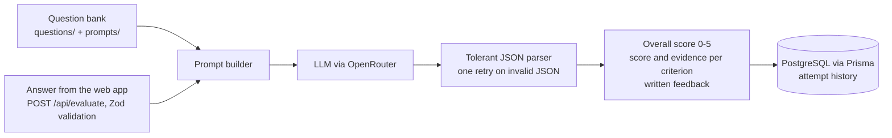
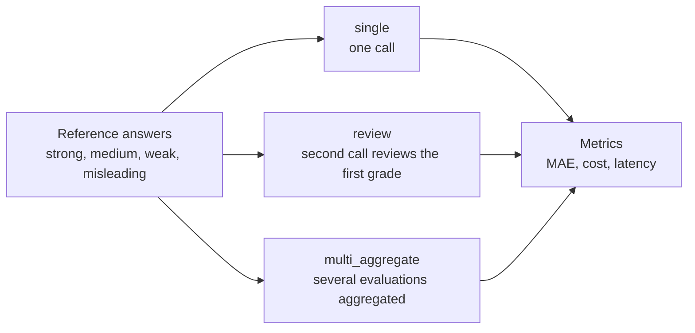

# LLM Grading Protocols for Open-Ended Software Engineering Questions

A web platform and experiment harness for grading open-ended Software Engineering answers (bug fixing, code quality, testing, architecture) with LLMs against a rubric, and for measuring which grading protocol is closest to a human-defined reference.

Final project (TCC) at UFMG.

## What is in it

- **Question bank** (`questions/`): Markdown files with front matter, a rubric (criteria and weights) and one prompt template per question (`prompts/`).
- **Evaluation API** (`POST /api/evaluate`): validates the input with Zod, builds the prompt, calls the model through OpenRouter and returns structured JSON: an overall score (0–5), a score and evidence per criterion, and written feedback. Model output is parsed tolerantly and retried once on invalid JSON.
- **Web app** (Next.js): browse questions, answer in a code editor, see results and attempt history. Auth with NextAuth, persistence with Prisma + PostgreSQL.
- **Experiment runner** (`scripts/`, `experiments/`): runs several grading protocols over reference answers with known expected scores and computes error, cost and robustness metrics.
- **Question-creation prompts** (`agents/`): prompts used to draft and review new questions.

## Architecture



The experiment runner applies one of three grading protocols to reference answers with known expected scores:



## Experiment

Three grading protocols, same model (`google/gemini-2.5-flash`):

- `single`: one call grades the answer.
- `review`: a second call reviews the first grade.
- `multi_aggregate`: several evaluations are aggregated.

Sample: 8 questions, 24 reference answers (strong, medium, weak and misleading profiles), 72 runs. All runs returned valid output.

| Protocol | Overall MAE (0–5) | Criterion MAE | Cost (credits, 24 runs) | Avg. latency |
|---|---|---|---|---|
| single | 0.266 | 0.514 | 0.093 | 7.0 s |
| review | 0.309 | 0.519 | 0.182 | 12.9 s |
| multi_aggregate | 0.255 | 0.454 | 0.278 | 20.2 s |

Aggregating evaluations gave the lowest error, a single call had the best cost-benefit, and the review step did not improve on the baseline. The sample is small, so the results are exploratory. Raw runs and metrics are in `experiments/results/experiment-runs/poc-ii-final/`.

## Stack

Next.js 15 (App Router), TypeScript, Prisma, PostgreSQL, NextAuth, Zod, Tailwind CSS, shadcn/ui, Recharts, Pino. See `docs/architecture.md`.

## Running

```bash
cp .env.example .env        # set DATABASE_URL, AUTH_SECRET, OPENROUTER_API_KEY (or USE_MOCK=true)
npm install
npx prisma migrate dev
npm run dev
```

Run the experiment (needs `OPENROUTER_API_KEY`), then compute the metrics:

```bash
npm run run:experiment -- --config experiments/configs/experiment-runner.final.json
npm run run:experiment-metrics -- --experiment-dir experiments/results/experiment-runs/poc-ii-final
```
