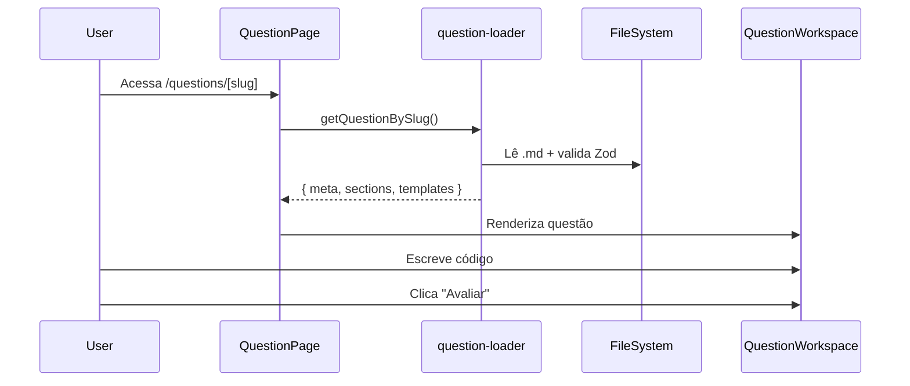
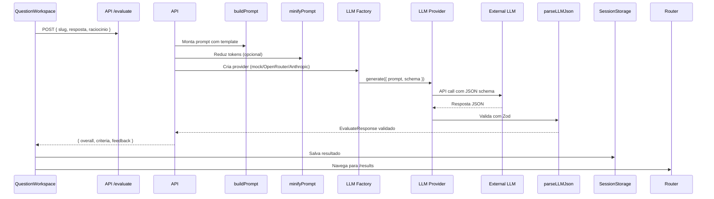
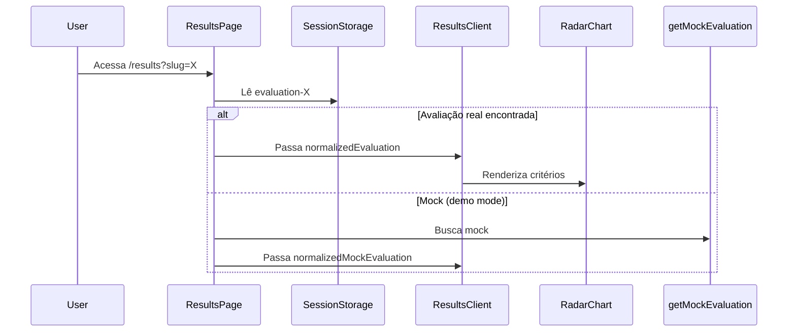

# Arquitetura do POC-ES

> **Plataforma de Avaliação de Código com IA**  
> Sistema educacional que avalia código além da correção funcional, focando em qualidade, boas práticas e raciocínio técnico.

---

## Visão Geral

O POC-ES é uma aplicação Next.js 15 (App Router) que integra modelos de linguagem (LLMs) para avaliar soluções de código de forma holística, considerando não apenas se o código funciona, mas _como_ ele foi escrito e _por quê_.

### Objetivos do Sistema

1. **Avaliação Qualitativa**: Analisar código com base em critérios além da correção funcional
2. **Feedback Educacional**: Fornecer feedback estruturado e acionável
3. **Flexibilidade**: Suportar múltiplas linguagens de programação e tipos de questão
4. **Transparência**: Expor critérios de avaliação e justificativas

---

## Estrutura de Diretórios

```
poc-es/
├── src/
│   ├── app/                      # Next.js App Router (rotas e páginas)
│   │   ├── api/evaluate/         # API de avaliação (POST)
│   │   ├── questions/[slug]/     # Página dinâmica de questão
│   │   ├── results/              # Visualização de resultados
│   │   └── ...
│   ├── components/               # Componentes React
│   │   ├── layout/               # Header, Breadcrumb
│   │   ├── domain/               # Welcome (específico do domínio)
│   │   ├── shared/               # Markdown, CodeEditor (reutilizáveis)
│   │   ├── ui/                   # Primitivos shadcn/ui
│   │   └── auth/                 # Login
│   ├── contexts/                 # Context API (auth, preferences)
│   ├── lib/                      # Lógica de negócio
│   │   ├── question-loader.ts    # Carrega questões do filesystem
│   │   ├── question-meta-schema.ts # Validação Zod de metadados
│   │   ├── evaluation-types.ts   # Tipos para avaliações
│   │   └── requestModule/        # Cliente HTTP para API
│   └── server/                   # Código backend
│       ├── evaluation/           # Build prompt, parse JSON, schemas
│       ├── llm/                  # Abstração de providers LLM
│       ├── config/               # Configurações de ambiente
│       └── observability/        # Logging estruturado (Pino)
├── questions/                    # Markdown das questões
│   ├── bugFix/
│   ├── codeQuality/
│   ├── design/
│   └── tests/
├── prompts/                      # Templates de prompt para LLMs
└── docs/                         # Documentação técnica
```

---

## Fluxo de Dados

### 1. **Resolução de Questão** (User → UI)



### 2. **Avaliação** (UI → API → LLM)



### 3. **Visualização de Resultados** (UI)



---

## Componentes Principais

### Frontend

#### `QuestionWorkspace` (Refatorado)

- **Responsabilidade**: Orquestrar resolução de questão
- **Hooks customizados**:
    - `useCodeEditor`: Gerencia código por linguagem
    - `useQuestionForm`: Gerencia formulários não-código
    - `useEvaluation`: Lida com chamada à API e navegação
- **Integrações**: Monaco Editor, Context API (preferences)

#### `ResultsClient`

- **Responsabilidade**: Exibir avaliação com gráficos e feedback
- **Componentes**: Recharts (Radar/Bar), Markdown inline
- **Estado**: Gerencia toggle entre avaliação real e mock

### Backend

#### `src/server/evaluation/`

- **`build-prompt.ts`**: Monta prompt usando Mustache com template + dados da questão
- **`minify-prompt.ts`**: Reduz tokens removendo espaços/comentários (ativa com `MINIFY_PROMPTS=true`)
- **`json-parser.ts`**: Valida JSON da LLM com retry logic (até 3x se inválido)
- **`schemas.ts`**: Zod schemas para request/response

#### `src/server/llm/`

- **`factory.ts`**: Factory pattern para criar provider baseado em env (`LLM_PROVIDER`)
- **`providers/`**:
    - `mock.ts`: Retorna avaliação fake para testes
    - `openrouter.ts`: Integração com OpenRouter API
    - `anthropic.ts`: Integração direta com Claude
- **Retry Logic**: Até 3 tentativas com backoff exponencial (2^n segundos)

#### `src/lib/question-loader.ts`

- **Responsabilidade**: Carrega questões do filesystem, valida metadata com Zod
- **Formato**: Front matter YAML + Markdown com delimitadores `<!-- SECTION:nome -->`
- **Cache**: Sem cache (re-read a cada request - OK para POC)

---

## Decisões de Arquitetura (ADRs)

### ADR-001: Next.js App Router

**Contexto**: Precisamos de SSR para SEO e carregamento rápido de questões.

**Decisão**: Usar App Router (Next.js 15) ao invés de Pages Router.

**Consequências**:

- Server Components por padrão (menos JS no cliente)
- Layouts aninhados e streaming
- Curva de aprendizado para diferenciar Server vs Client Components

### ADR-002: LLM Provider Abstraction

**Contexto**: Queremos trocar entre LLMs (mock, Claude, GPT) sem reescrever código.

**Decisão**: Factory pattern com interface `LLMProvider` comum.

**Consequências**:

- Fácil adicionar novos providers
- Mock para testes e desenvolvimento
- JSON schema pode não funcionar igual em todos os LLMs

### ADR-003: Markdown + Front Matter para Questões

**Contexto**: Questões precisam de metadados (dificuldade, linguagens) e conteúdo rich text.

**Decisão**: Usar arquivos `.md` com front matter YAML e delimitadores customizados.

**Consequências**:

- Fácil edição (git-friendly)
- Versionamento de questões
- Sem validação em tempo de edição (depende de Zod em runtime)

### ADR-004: SessionStorage para Resultados

**Contexto**: POC sem backend persistente.

**Decisão**: Salvar avaliações no `sessionStorage` do navegador.

**Consequências**:

- Simples de implementar
- Resultados perdidos ao fechar navegador
- **TODO**: Migrar para backend (Redis/Postgres) quando disponível

### ADR-005: Logging Estruturado com Pino

**Contexto**: Console.log dificulta debugging em produção.

**Decisão**: Usar biblioteca `pino` com logs estruturados (JSON).

**Consequências**:

- Logs filtráveis e searcháveis
- Integração fácil com ferramentas de APM (Datadog, Sentry)
- Requer adaptação de código existente (removendo console.log)

---

## Segurança

### Validação de Input

- **Zod schemas** em todas as camadas (API request, LLM response, question metadata)
- **Sanitização**: Mustache escapa HTML automaticamente nos templates

### Environment Variables

- **Secrets**: `ANTHROPIC_API_KEY`, `OPENROUTER_API_KEY` nunca commitados
- **Validação**: `zod` valida env vars no boot (crash se inválidas)

### Headers de Segurança

**Implementado** (Sprint 1):

- `X-Frame-Options: DENY`
- `X-Content-Type-Options: nosniff`
- `Referrer-Policy: strict-origin-when-cross-origin`

**TODO**: Rate limiting na API `/evaluate` (próxima fase)

---

## Observabilidade

### Logging

- **Biblioteca**: Pino (estruturado JSON)
- **Níveis**: `error`, `warn`, `info`, `debug`
- **Contexto**: Logs incluem `slug`, `userId`, `provider`, etc.

### Métricas (Futuro)

- Latência de LLM por provider
- Taxa de erros de parsing JSON
- Distribuição de notas por questão

---

## Testing

### Cobertura Atual

- **Nenhum teste automatizado** (identificado em review)

### Plano de Testes (Sprint 2)

1. **Unitários** (Vitest):
    - `json-parser.ts` (retry logic)
    - `question-loader.ts` (validação Zod)
    - `mock.provider.ts`
2. **Integração**:
    - API `/evaluate` end-to-end com mock
3. **E2E** (Playwright - futuro):
    - Fluxo completo: questão → avaliar → resultados

---

## Deploy

### Vercel (Production)

- **Build**: `npm run build`
- **Environment**: Vercel automaticamente injeta env vars
- **Caching**: Next.js ISR não usado (questões sempre frescas)

### Requisitos

- Node.js 18+
- Variáveis de ambiente:
    - `LLM_PROVIDER` (mock | openrouter | anthropic)
    - `ANTHROPIC_API_KEY` (se anthropic)
    - `OPENROUTER_API_KEY` (se openrouter)
    - `MINIFY_PROMPTS` (opcional, true/false)

---

## Roadmap Técnico

### Concluído

- Arquitetura Next.js 15 com App Router
- Integração LLM com retry e validação
- Sistema de rubricas flexível
- Responsividade mobile
- Logging estruturado

### Em Progresso

- Testes automatizados (Vitest)
- Refatoração de componentes grandes
- Type safety completo (Zod schemas)

### Backlog

- Backend persistente (Prisma + Postgres)
- Autenticação real (NextAuth.js)
- Rate limiting
- Métricas e observabilidade avançada
- Modo colaborativo (múltiplos usuários)
- Editor diff para comparar soluções

---

## Referências

- [Next.js App Router Docs](https://nextjs.org/docs/app)
- [Zod Schema Validation](https://zod.dev/)
- [Pino Logger](https://getpino.io/)
- [Recharts](https://recharts.org/)
- [shadcn/ui](https://ui.shadcn.com/)

---

**Última atualização**: 1º de novembro de 2025  
**Versão**: 1.0  
**Autor**: Time POC-ES
